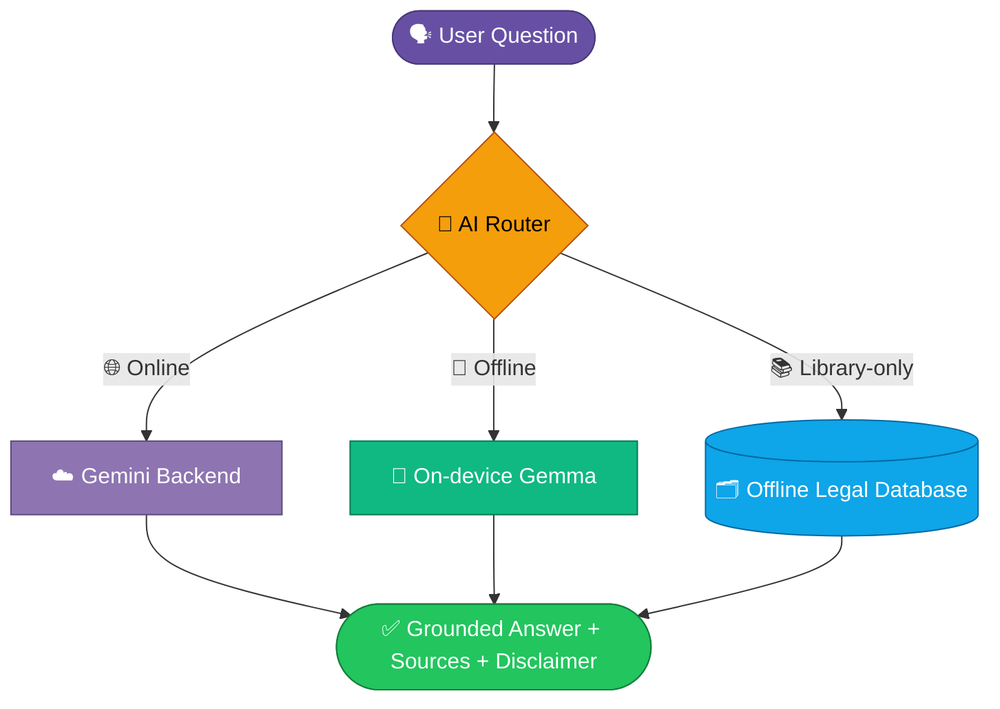

<div align="center">


### ⚖️ Know your rights. Stay safe. Get prepared.

**🏆 Build with AI Multan 2026 · SKYRA Pakistan**

<p>
  
  
  
  
  
  
</p>

<p>
  
  
  
  
  
  
</p>

<p>
  <a href="https://github.com/AqibTayyab/haqooq-mobile-app"><b>📦 Repository</b></a> ·
  <a href="#-project-overview"><b>📖 Overview</b></a> ·
  <a href="#-features"><b>✨ Features</b></a> ·
  <a href="#-demo-and-apk"><b>🎬 Demo & APK</b></a> ·
  <a href="#-installation"><b>⚙️ Installation</b></a> ·
  <a href="#-usage"><b>🚀 Usage</b></a> ·
  <a href="#-architecture"><b>🏗️ Architecture</b></a> ·
  <a href="#-team"><b>👥 Team</b></a>
</p>

</div>

---

> [!WARNING]
> **HAQOOQ provides general legal information only — not legal advice.**
> It does not replace a licensed lawyer, legal-aid organization, court, police department, or emergency service. For urgent legal, safety, or criminal matters, contact a qualified professional or the appropriate emergency service.

---

## 📖 Project Overview

**HAQOOQ** is a multilingual citizen legal guide and personal-safety application designed for people in Pakistan. It helps users understand their legal rights, read legal information in simple language, prepare for a lawyer consultation, respond during emergencies, and connect with legal support.

Built for Android using **Flutter**, HAQOOQ supports:

- 🌐 **English, Urdu (with full RTL layout), and Roman Urdu**
- 🎨 **Material 3 Expressive** dark and light interface
- 📴 **Offline legal-rights guidance**
- 🤖 **Online Gemini-powered AI assistant**
- 🚨 **Emergency SOS** and ⏱️ **Safety Check-In**
- 👩‍⚖️ **Demo lawyer directory** with consultation workflow

---

## 🎯 The Problem

Many people in Pakistan struggle to understand their legal rights in stressful situations: **police stops, arrest, harassment, workplace issues, family disputes, cybercrime, or consumer complaints.**

| ❌ The Challenge | ✅ How HAQOOQ Helps |
|---|---|
| Legal text is written in difficult language | Plain-language guidance in English, Urdu, and Roman Urdu |
| Information is mostly English-only | Full multilingual interface with RTL support |
| Hard to access during an emergency | Offline legal-rights library and one-tap SOS |
| People don't know what to ask a lawyer | AI assistant and a user-consented Lawyer Briefing Pack |
| No clear next steps | Grounded answers with sources, next steps, and disclaimers |

HAQOOQ is a **practical legal-safety companion**. It helps users organize information, understand possible next steps, and communicate more clearly — before they speak to a lawyer or authority.

---

## ✨ Features

| | Feature | Detail |
|---|---|---|
| 🌐 | **Multilingual interface** | English, Urdu with RTL layout support, and Roman Urdu |
| 🎨 | **Material 3 interface** | Android Material 3 Expressive dark and light themes |
| 🧭 | **Adaptive navigation** | Floating bottom dock for compact screens, navigation rail for tablets and foldables |
| 📴 | **Offline legal-rights guidance** | Plain-language legal-rights information without internet |
| 🤖 | **Online AI assistant** | Gemini-powered legal-information assistant through a secure backend |
| 🧠 | **Offline AI support** | On-device AI assistance for basic legal-rights questions |
| 🚨 | **Emergency SOS** | One-tap alert with location, battery status, trusted contacts, and pre-filled SMS/share options |
| ⏱️ | **Safety Check-In** | Scheduled safety confirmation with local notification on expiry |
| 👩‍⚖️ | **Lawyer directory** | Search, filters, lawyer profiles, reviews, and consultation booking |
| 💬 | **Demo lawyer chat** | Scripted multilingual demo chat and booking flow |
| 📁 | **Lawyer Briefing Pack** | User-consented case briefing material for consultation |
| 🌗 | **Dark and light mode** | True-black (`#000000`) dark mode and light mode toggle |
| 💾 | **Local data storage** | Trusted contacts, SOS history, and check-in data stored on-device |
| ♿ | **Accessibility and clarity** | Simple language, clear labels, multilingual support |

---

## 🧩 What We Built

<details open>
<summary><b>🎨 Interface, Localization & Design</b></summary>

- Complete string tables for English, Urdu, and Roman Urdu
- Urdu support with automatic right-to-left layout direction
- Locale persistence through `LocaleController`
- True-black dark mode using `#000000`
- Light mode toggle in the top bar, onboarding, and settings
- Locally bundled fonts: **Plus Jakarta Sans**, **Inter**, and **Noto Naskh Arabic**
- Adaptive navigation using `ExpressiveFloatingBottomDock` on compact screens
- Navigation rail support for tablets and foldables

</details>

<details open>
<summary><b>🤖 Online AI & Backend</b></summary>

- Node.js and Express backend
- Secure Gemini API proxy — the API key never ships inside the mobile app
- Flutter online AI service
- AI router for online and offline modes
- Health checker
- Automated tests, evaluation set, and project documentation

</details>

<details open>
<summary><b>📴 Offline Legal Intelligence</b></summary>

- Offline legal-rights content
- Legal database and retrieval workflow
- On-device AI support when internet is unavailable
- Grounded legal-information responses

</details>

<details open>
<summary><b>🚨 Emergency SOS & Safety</b></summary>

- Persistent trusted contacts: add, edit, primary-contact selection, delete (maximum of **five**)
- Pakistani mobile-number validation
- Runtime location and notification permission checks, with an App Settings shortcut for denied permissions
- Emergency helplines: **15, 1122, 1099, and 1991**
- Local SOS incident history
- Three-second cancelable SOS countdown with tactile vibration
- Real GPS location with last-known-location fallback
- Battery percentage in the SOS alert
- Multilingual SOS alert messages with a Google Maps location link
- Honest pre-filled SMS intent, Share Sheet, and copy option
- Dialer intent for emergency helplines
- Persistent Safety Check-In countdown with local notification on expiry

</details>

<details open>
<summary><b>👩‍⚖️ Legal Support Workflow</b></summary>

- Lawyer search with city, specialization, and spoken-language filters
- Demo lawyer profiles and scripted multilingual demo chat
- Demo consultation booking
- Explicit user consent before attaching a Lawyer Briefing Pack
- Post-booking demo reviews
- Manual QA checklist

</details>

---

## 🛡️ Legal and Safety Principles

> [!IMPORTANT]
> **General legal information only.** Every AI response, lawyer profile, and dashboard displays a mandatory disclaimer. Users should verify important legal information with a qualified legal professional before acting.

> [!NOTE]
> **Honest SMS and calling behavior.** HAQOOQ never sends silent background SMS messages or places calls without user action. Tapping **Send SMS Alert** or **Call** opens the device SMS or dialer app with a pre-filled recipient and message. The user must manually confirm. This protects consent and follows responsible mobile-app practices.

> [!CAUTION]
> **Background Check-In limitation.** The Safety Check-In deadline is stored locally and survives an app restart. The live countdown runs while the app process is active — aggressive battery-saving features may pause timers if the operating system stops the app process.

> [!TIP]
> **Demo lawyer profiles.** All lawyer profiles, ratings, bookings, and replies in the demo are fictional and clearly labeled: **`Demo Account — Not a Real Lawyer`**

> [!WARNING]
> **Emergency numbers.** Helplines 15, 1122, 1099, and 1991 should be verified locally before relying on them in a critical emergency.

---

## 🎬 Demo and APK

The compiled Android APK and demo video are available through Google Drive, so reviewers and judges can test HAQOOQ without building from source.

<div align="center">

| 📦 Item | 🔗 Link |
|---|---|
| ⬇️ **Download HAQOOQ APK** | [Download APK from Google Drive](https://drive.google.com/drive/folders/1LDgRTBnbCe2SEGzroJhFI0MBXL0ZXB7d) |
| ▶️ **Watch HAQOOQ Demo Video** | [Watch Demo Video on Google Drive](https://drive.google.com/drive/folders/1LDgRTBnbCe2SEGzroJhFI0MBXL0ZXB7d) |
| 📂 **Open Demo and APK Folder** | [Open Demo and APK Folder](https://drive.google.com/drive/folders/1LDgRTBnbCe2SEGzroJhFI0MBXL0ZXB7d) |

</div>

### 🔐 APK Safety Notice

The APK is a hackathon demonstration build distributed through Google Drive, not the Google Play Store. Android may show a warning such as *"This app is from an unverified developer"* or *"Play Protect has blocked the installation."* This does **not** automatically mean the file is unsafe — but please download the APK **only** from the official links above.

### 📲 Install the APK

1. Download the APK from the Google Drive link.
2. Open the downloaded APK on an Android device.
3. If Android shows a warning, choose **Install Anyway** only if you trust the source.
4. Allow installation from the browser or file manager if prompted.
5. Complete the installation and open **HAQOOQ**.
6. For online AI features, make sure the Gemini backend is running and the app is connected to the backend URL.

### 🎥 What the Demo Video Shows

- Opening the app and switching between **English, Urdu, and Roman Urdu**
- Switching between **dark and light mode**
- Browsing the **legal-rights library** and asking a legal-rights question
- Using the **AI assistant**
- Testing **Emergency SOS** and **Safety Check-In**
- Searching the **lawyer directory**, opening a demo profile, starting a demo chat, and booking a demo consultation

---

## ⚙️ Installation

### 📋 Requirements

- Flutter SDK
- Android Studio or VS Code with Flutter extensions
- Android SDK
- Android device or emulator
- Node.js *(only for the Gemini backend)*
- A Gemini API key *(only for online AI features)*

### 1️⃣ Clone the repository

```bash
git clone https://github.com/AqibTayyab/haqooq-mobile-app.git
cd haqooq-mobile-app
```

### 2️⃣ Run the mobile application

The runnable Flutter app is in the `app/` directory.

```bash
cd app
flutter pub get
flutter analyze
flutter test
flutter run
```

If multiple devices are connected, select your Android device or emulator when prompted.

<details>
<summary><b>📱 Run on a physical Android phone</b></summary>

1. Enable **Developer Options** on your phone.
2. Enable **USB Debugging**.
3. Connect the phone to your computer via USB and accept the debugging prompt.
4. Confirm the device appears:
   ```bash
   flutter devices
   ```
5. Run:
   ```bash
   flutter run
   ```

</details>

### 3️⃣ Run the Gemini backend

The backend is located in `member2/backend/`. Open a **second terminal**:

```bash
cd member2/backend
npm install
cp .env.example .env
```

Edit `.env` and add your key:

```env
GEMINI_API_KEY=your-gemini-api-key
GEMINI_MODEL=gemini-2.5-flash
APP_PUBLIC_KEY=haqooq-demo-app
```

Start the backend:

```bash
set -a
source .env
set +a
npm start
```

The backend runs at `http://localhost:8080`.

### 4️⃣ Connect the app to the backend

Find your computer's local IP address:

```bash
hostname -I
```

Example output: `192.168.1.5`

Run the Flutter app with the backend URL:

```bash
cd app
flutter run \
  --dart-define=BACKEND_BASE_URL=http://192.168.1.5:8080 \
  --dart-define=APP_PUBLIC_KEY=haqooq-demo-app
```

> [!NOTE]
> Replace `192.168.1.5` with your actual local IP. Your Android phone and computer must be on the **same Wi-Fi network**.

---

## 🚀 Usage

<details open>
<summary><b>💬 Ask a legal question</b></summary>

1. Open the **AI Chat** screen.
2. Select your preferred language.
3. Ask a question, for example:

```text
Police ne mujhe roka hai, kya karun?
```

4. HAQOOQ responds with legal information, relevant sources, next steps, and a disclaimer.

</details>

<details open>
<summary><b>🚨 Use Emergency SOS</b></summary>

1. Open the **SOS** screen.
2. Add trusted contacts.
3. Press the **SOS** button.
4. Confirm or cancel within the 3-second countdown.
5. The app prepares an emergency message with your location and battery status.
6. Choose a contact and send the alert through your device SMS app.

</details>

<details open>
<summary><b>⏱️ Use Safety Check-In</b></summary>

1. Open **Safety Check-In**.
2. Select a check-in time (15, 30, or 60 minutes).
3. Tap **I'm Safe** before the timer ends.
4. If the timer expires, HAQOOQ notifies you and prepares an alert for your trusted contacts with your last known location. You confirm and send it yourself.

</details>

<details open>
<summary><b>👩‍⚖️ Find legal support</b></summary>

1. Open the **Lawyer Directory**.
2. Filter by city, specialization, language, or fee.
3. View a lawyer profile.
4. Start a demo chat or book a demo consultation.

</details>

---

## 🏗️ Architecture

### 📁 Project structure

```text
haqooq-mobile-app/
├── app/          # Runnable Flutter application
├── docs/         # Project documentation
├── members/      # Team member documentation
├── member2/      # Gemini backend and Flutter AI client
├── member3/      # Offline legal database, RAG, and on-device AI
├── starter_repo/ # Shared base application and contracts
├── tools/        # App assembly and utility scripts
└── public/       # Static assets
```

### 🧱 Technology stack

| Layer | Technology | Purpose |
|---|---|---|
| 📱 Mobile app | Flutter | Cross-platform UI (Android build; iOS planned) |
| 🎨 UI framework | Material 3 | Modern adaptive interface |
| 🌐 Localization | Custom localization system | English, Urdu, and Roman Urdu |
| 🤖 Online AI | Gemini API | Legal-information assistant |
| ⚙️ Backend | Node.js and Express | Secure Gemini API proxy |
| 🧠 Offline AI | Gemma on-device model | Basic offline legal-rights assistance |
| 👩‍⚖️ Lawyer directory | JSON-based demo service | Search, profiles, chat, and booking |
| 🚨 Emergency features | Device location, SMS, dialer, notifications | SOS and Safety Check-In |

### 🤖 AI architecture



Answers are grounded in verified legal-rights content. If the available information is insufficient, HAQOOQ recommends contacting a licensed lawyer instead of generating unsupported legal claims.

---

## 🔒 Security and Privacy

| 🔍 Concern | 🛡️ Approach |
|---|---|
| API key exposure | Gemini API key lives only in backend environment variables, never in the mobile app |
| Sensitive case data | Encrypted local storage and user-controlled deletion |
| Location sharing | Shared only with contacts selected by the user |
| Police notifications | Require explicit user consent |
| Demo lawyer accounts | Clearly labeled as fictional and non-licensed |
| Legal misinformation | Responses grounded in reviewed legal-rights content, with disclaimers |

---

## 🧪 Testing

```bash
# Flutter analysis
cd app
flutter analyze

# Flutter tests
flutter test

# Backend tests
cd ../member2/backend
npm install
npm test
```

### ✅ Manual QA Checklist

| ID | Feature / Scenario | Expected Result | Status |
|---|---|---|---|
| QA-01 | Trusted Contacts CRUD and validation | Invalid numbers rejected; max five contacts; edit, primary star, and delete persist across restart | ✅ Pass |
| QA-02 | Permissions and App Settings flow | Runtime location and notification prompts work; denied state offers App Settings shortcut | ✅ Pass |
| QA-03 | Three-second SOS countdown and cancel | Vibrates 3 → 2 → 1; Cancel aborts without logging an incident | ✅ Pass |
| QA-04 | SOS GPS, battery, and honest SMS/share | Attaches Google Maps location or honest GPS-off text; opens pre-filled SMS, Share, or Copy cleanly | ✅ Pass |
| QA-05 | Safety Check-In timer | 15, 30, 60 min presets count down, persist deadline, cancel via "I'm Safe," and trigger alert and notification at 00:00 | ✅ Pass |
| QA-06 | Emergency helplines dialer | 15, 1122, 1099, 1991 show verify-locally notice and open dialer without auto-calling | ✅ Pass |
| QA-07 | Lawyer search, filters, demo banner | Search, city, topic, and language chips filter lawyers; demo banner visible everywhere | ✅ Pass |
| QA-08 | Demo booking, consent, and reviews | Explicit consent toggle for Lawyer Briefing Pack; review dialog unlocked only after booking | ✅ Pass |
| QA-09 | Multilingual, RTL, dark, and light mode | All labels, dialogs, and SOS templates render cleanly in English, Urdu RTL, and Roman Urdu in both themes | ✅ Pass |

---

## 🗺️ Roadmap

| Version | Feature | Status |
|---|---|---|
| **v1.0** | Multilingual legal-rights library, AI assistant, SOS, Safety Check-In, lawyer directory |  |
| **v1.1** | Verified lawyer onboarding and real consultation payments |  |
| **v1.1** | Official police and legal-aid integrations |  |
| **v1.2** | Improved offline Urdu AI model |  |
| **v1.2** | Document analysis for FIRs, notices, and contracts |  |
| **Future** | iOS release and app-store publication |  |

---

## 👥 Team

<div align="center">

<table>
  <tr>
    <td align="center" width="300">
      <a href="https://github.com/rayan208">
        <br />
        <b>Rayan Siddiqui</b>
      </a><br /><br />
      <a href="https://github.com/rayan208"></a>
      <a href="https://www.linkedin.com/in/rayan-siddiqui-46825a377/"></a>
    </td>
    <td align="center" width="300">
      <a href="https://github.com/AqibTayyab">
        <br />
        <b>Muhammad Aqib Tayyab</b>
      </a><br /><br />
      <a href="https://github.com/AqibTayyab"></a>
      <a href="https://www.linkedin.com/in/muhammad-aqib-tayyab-ethical-hacker/"></a>
    </td>
  </tr>
</table>

</div>

---

## 📄 License

This project was created for the **Build with AI Multan 2026** hackathon.

<div align="center">


**Made with ❤️ in Multan, Pakistan 🇵🇰**

</div>
